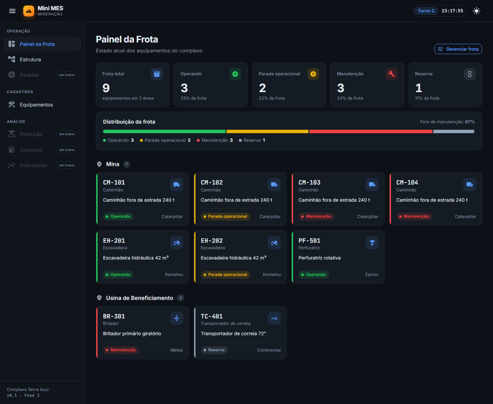
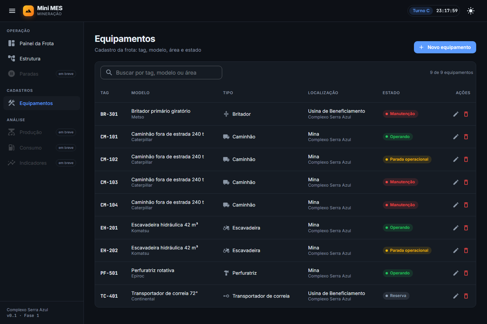
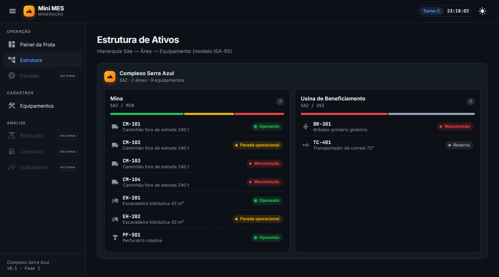
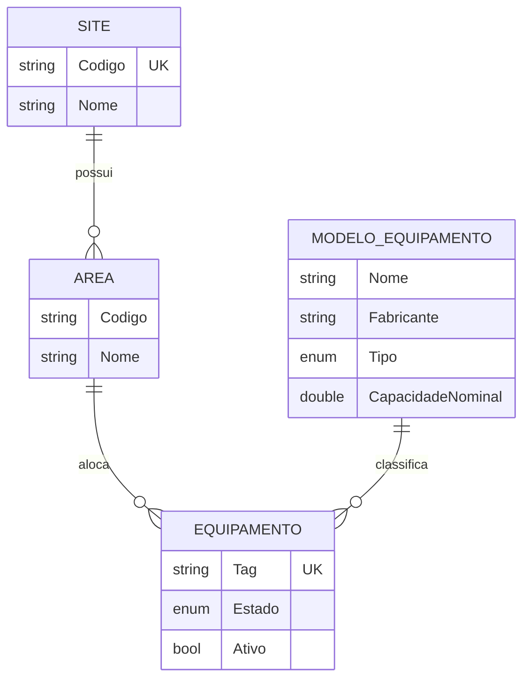
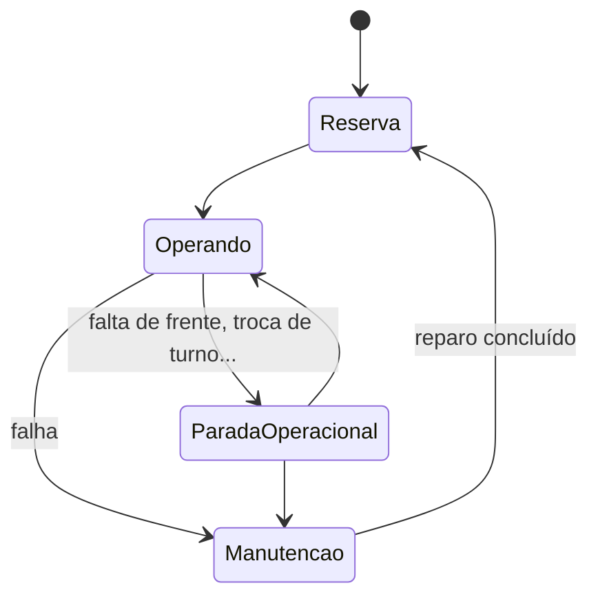

# ⛏️ Mini MES · Mineração


**Sistema MES (Manufacturing Execution System) para mineração**, com cadastro da frota na hierarquia **ISA-95** (Site → Área → Equipamento), **painel em tempo real** do estado dos equipamentos e, nas próximas fases, **simulador de frota**, **apontamento de paradas**, **produção e consumo por turno** e **indicadores operacionais** (DF, UF, MTBF, MTTR).

> Projeto de portfólio inspirado na rotina de um MES de mineração real: mesmo vocabulário (apontamento, parada operacional, turno, disponibilidade física) e as mesmas regras de negócio, em uma versão enxuta que roda **100% local**.



> ⚠️ O **Complexo Serra Azul** e todos os dados exibidos são **fictícios**, gerados automaticamente na primeira execução. Projeto sem vínculo com nenhuma mineradora.

---

## 🚀 Funcionalidades

### Painel da Frota
- **KPIs por estado** (Operando, Parada operacional, Manutenção, Reserva) com **% da frota**
- **Barra de distribuição da frota** com o indicador "fora de manutenção" (prévia da DF)
- Equipamentos **agrupados por área**, com faixa lateral na cor do estado e indicador pulsante para "Operando"
- **Relógio com turno atual** no topo (A · B · C)

### Estrutura de Ativos (ISA-95)
- Visão hierárquica **Site → Área → Equipamento**
- **Distribuição de estados por área**

### Cadastro de Equipamentos
- **CRUD completo**: novo, editar e excluir (com confirmação)
- **Busca** por tag, modelo ou área
- Equipamento vinculado a um **Modelo de Equipamento** (tipo, fabricante e capacidade nominal vêm do modelo, não são digitados)
- **Regras de negócio validadas no serviço** com mensagens amigáveis na tela

### Interface
- **Modo escuro e claro**
- Layout responsivo com menu lateral por seções: **Operação · Cadastros · Análise**
- Componentes reutilizáveis (`EstadoBadge`, `DistribuicaoEstados`)

<table>
  <tr>
    <td></td>
    <td></td>
  </tr>
  <tr>
    <td align="center"><b>Cadastro de Equipamentos</b></td>
    <td align="center"><b>Estrutura de Ativos</b></td>
  </tr>
</table>

---

## 📋 Regras de Negócio

| Código | Regra |
|--------|-------|
| **RN-001** | A tag do equipamento é **obrigatória** e tem no máximo **20 caracteres** |
| **RN-002** | A tag é **única**, sem diferenciar maiúsculas/minúsculas (`cm-101` = `CM-101`). Espaços nas pontas são removidos e a tag é gravada em maiúsculas |
| **RN-003** | Todo equipamento precisa de um **modelo** e de uma **área** válidos |
| **RN-004** | Modelos e áreas **não podem ser excluídos** enquanto tiverem equipamentos vinculados |
| **RN-005** | Escala de **três turnos de 8h**: A (06h–14h), B (14h–22h) e C (22h–06h) |

### Modelo de dados


### Estados do equipamento


---

## 🛠️ Tecnologias

| Camada | Tecnologia |
|--------|-----------|
| Linguagem | C# 12 · .NET 8 |
| Interface | Blazor Server (renderização interativa) · MudBlazor 7 · CSS próprio |
| Persistência | Entity Framework Core 8 · SQLite · Migrations |
| Testes | xUnit · SQLite em memória |
| Fontes | Inter · JetBrains Mono |

---

## 🗂️ Estrutura do Projeto

```
src/
├── Mes.Domain/              # Regras do negócio — não conhece banco nem tela
│   ├── Equipamento.cs       #   Equipamento (tag, estado, modelo, área)
│   ├── ModeloEquipamento.cs #   Modelo de fabricante (tipo, capacidade)
│   ├── Site.cs · Area.cs    #   Hierarquia ISA-95
│   ├── Turnos.cs            #   Escala de turnos A/B/C
│   └── RegraDeNegocioException.cs
├── Mes.Infrastructure/      # Banco de dados e serviços
│   ├── MesDbContext.cs      #   Mapeamento EF Core (índices únicos, enums como texto)
│   ├── EquipamentoService.cs#   Casos de uso + validação das regras RN-001 a RN-003
│   ├── DadosIniciais.cs     #   Complexo de exemplo criado na 1ª execução
│   └── Migrations/          #   Histórico de versões do banco
├── Mes.Simulator/           # Simulador da frota (Fase 2)
└── Mes.Web/                 # Interface Blazor
    ├── Components/Pages/    #   Painel, Estrutura, Equipamentos (+ diálogo de cadastro)
    ├── Components/Layout/   #   Layout, menu e relógio de turno
    ├── Components/          #   Componentes reutilizáveis (EstadoBadge, DistribuicaoEstados)
    └── wwwroot/mes.css      #   Identidade visual
tests/
└── Mes.Tests/               # Testes automatizados (xUnit)
```

---

## ⚙️ Como Rodar

### Pré-requisitos
- [SDK do .NET 8](https://dotnet.microsoft.com/download/dotnet/8.0)

### Executar
```bash
git clone https://github.com/itjuanr/mini-mes-mineracao.git
cd mini-mes-mineracao
dotnet run --project src/Mes.Web
```
Acesse **http://localhost:5290**. O banco SQLite (`mes.db`) é criado automaticamente, já com dados de exemplo.

### Testes
```bash
dotnet test
```

### Migrations (ao alterar o modelo de dados)
```bash
dotnet tool restore
dotnet ef migrations add NomeDaMudanca --project src/Mes.Infrastructure --startup-project src/Mes.Web
```

---

## 🧪 Testes

**16 testes automatizados**, cobrindo as regras de negócio com um banco SQLite em memória recriado a cada teste:

- **Cadastro:** gravação válida, normalização da tag, tag vazia, tag acima do limite, tag duplicada, edição sem falso positivo de duplicidade, equipamento sem modelo e exclusão
- **Turnos:** **análise de valor-limite** nas fronteiras de cada turno (05:59, 06:00, 13:59, 14:00, 21:59, 22:00, 00:00)

---

## 🗺️ Roadmap

- [x] **Fase 0:** estrutura do projeto e painel inicial
- [x] **Fase 1:** cadastro de ativos (Site → Área → Equipamento) com banco de dados e testes
- [ ] **Fase 2:** simulador de frota (máquina de estados com eventos)
- [ ] **Fase 3:** painel em tempo real (SignalR)
- [ ] **Fase 4:** apontamento de paradas e árvore de motivos
- [ ] **Fase 5:** produção e consumo por turno
- [ ] **Fase 6:** indicadores (DF, UF, MTBF, MTTR) e gráficos
- [ ] **Fase 7:** testes E2E, Docker e CI no GitHub Actions

---

**Desenvolvido com 💙 por Juan Rodrigues**
**Status:** Em desenvolvimento
**Versão:** 0.1 · Fase 1 concluída: cadastro de ativos, banco de dados, 16 testes automatizados e nova identidade visual.
